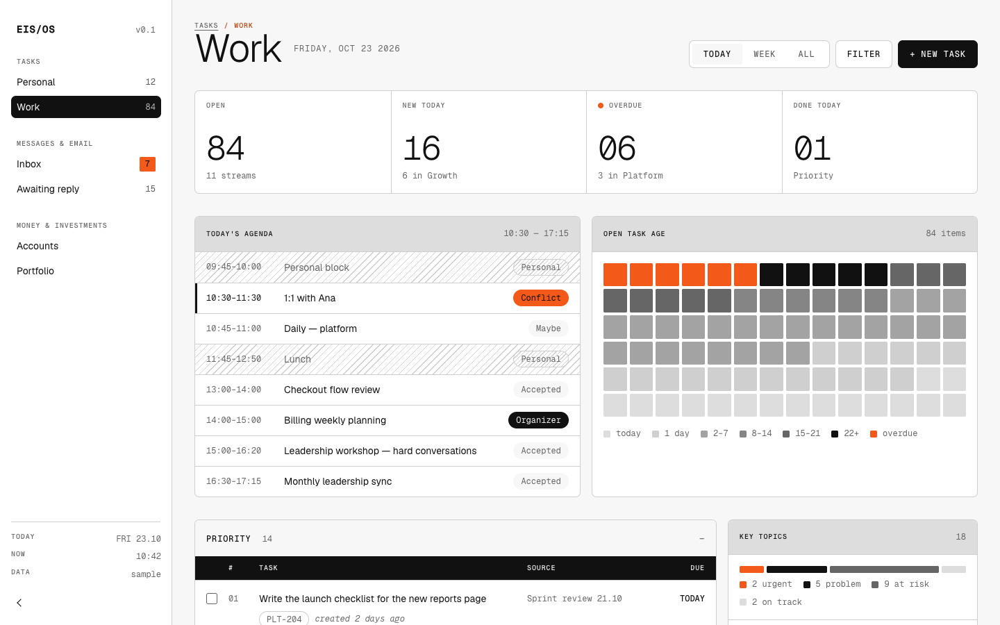

# eis-ds

A visual design system in plain HTML and CSS. Minimal retrofuturism: cool neutrals, thin lines, a mono voice for data and one orange accent.

It is several design systems in one. They share the same base and never conflict:

| Folder | For | Link (compiled, one file) |
|---|---|---|
| `src/shared/` | Every project: fonts, tokens, base, elements | Imported by each scope |
| `src/web/` | Websites, landing pages, documentation | `dist/eis-web.min.css`, optional `src/web/js/lines.js` |
| `src/app/` | Dashboards, tools, system screens | `dist/eis-app.min.css` |

More scopes (slides, email) will follow the same pattern.

Version 0.1, draft. Light mode only.

Site: https://diegoeis.github.io/eis-ds/

[](https://diegoeis.github.io/eis-ds/site/examples/dashboard/tasks-work.html)

*Example dashboard (app scope), with fictional data. [Open it live](https://diegoeis.github.io/eis-ds/site/examples/dashboard/tasks-work.html).*

## Use it

No package and no build step.

1. Link one file. Each scope has one minified file in `dist/` with shared, the scope tokens and the components. Only the fonts load from Google Fonts.

| Scope | File |
|---|---|
| Web | `dist/eis-web.min.css` |
| App | `dist/eis-app.min.css` |

Copy the file into your project, or link it from the published site or from a release tag (replace `<tag>`, for example `v0.4.0`):

```html
<link rel="stylesheet" href="eis-ds/eis-app.min.css">
<link rel="stylesheet" href="https://diegoeis.github.io/eis-ds/dist/eis-app.min.css">
<link rel="stylesheet" href="https://cdn.jsdelivr.net/gh/diegoeis/eis-ds@<tag>/dist/eis-app.min.css">
```

To read or change the source, copy `src/shared/` and one scope (`src/web/` or `src/app/`) and link `app/app.css` or `web/web.css`. These files import the others, so keep `shared/` next to the scope folder. The web line art script stays in `src/web/js/lines.js`.

3. Build with native HTML: shared classes (`eis-button`, `eis-chip`, `eis-panel`…) and the classes of your scope (`eis-app-*` or `eis-web-*`). Your own CSS holds layout only.
4. Check the piece against `docs/manual/checklist.md`.

## Documentation

- `index.html` — landing page.
- `site/foundations.html`, `site/elements.html`, `site/examples.html` — the visual manual: tokens, elements and examples, running live.
- `docs/manual/` — the written rules: which token, which element, page layout, scopes, checklist. Written to be applied literally by people and LLMs.
- `docs/tokens.md` — the token format (W3C Design Tokens Format Module 2025.10).
- `docs/visual-guidance/visual-guidance.md` — visual direction, Pinterest references and the decision log.

## Change it

Tokens are the source of truth, in `src/<scope>/tokens/*.tokens.json`. Never edit a generated `tokens.css`.

```sh
python3 scripts/build-tokens.py   # validate the tokens of every scope and write each tokens.css
python3 scripts/check-css.py      # check that scopes never use each other's classes or variables
python3 scripts/build-css.py      # write dist/eis-<scope>.min.css. Run it after every CSS change and commit dist/
```

`python3 scripts/build-css.py --check` fails if `dist/` is not up to date. Run it before you create a release tag.

Both scripts use the Python standard library only. Contributor and agent rules are in `AGENTS.md`.
